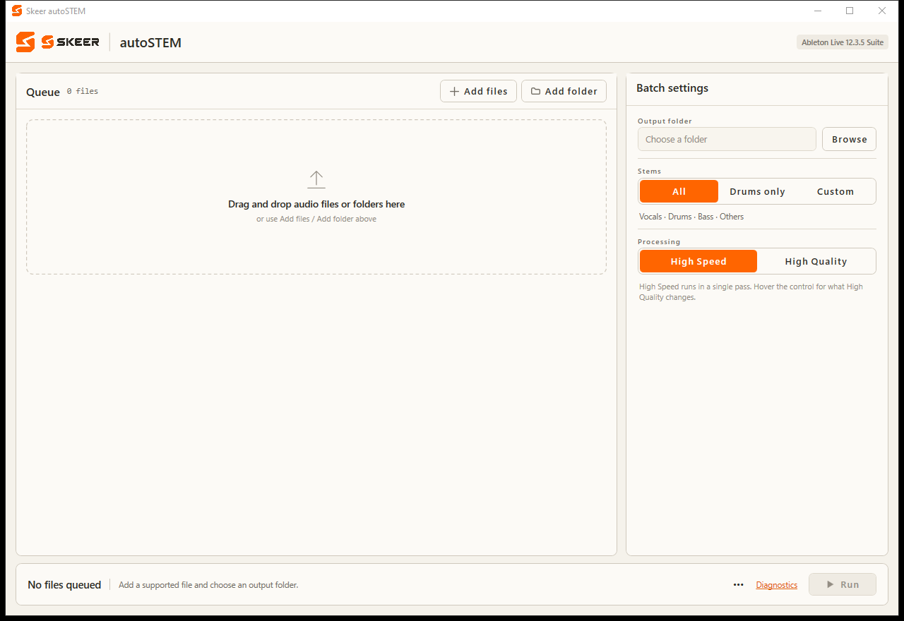
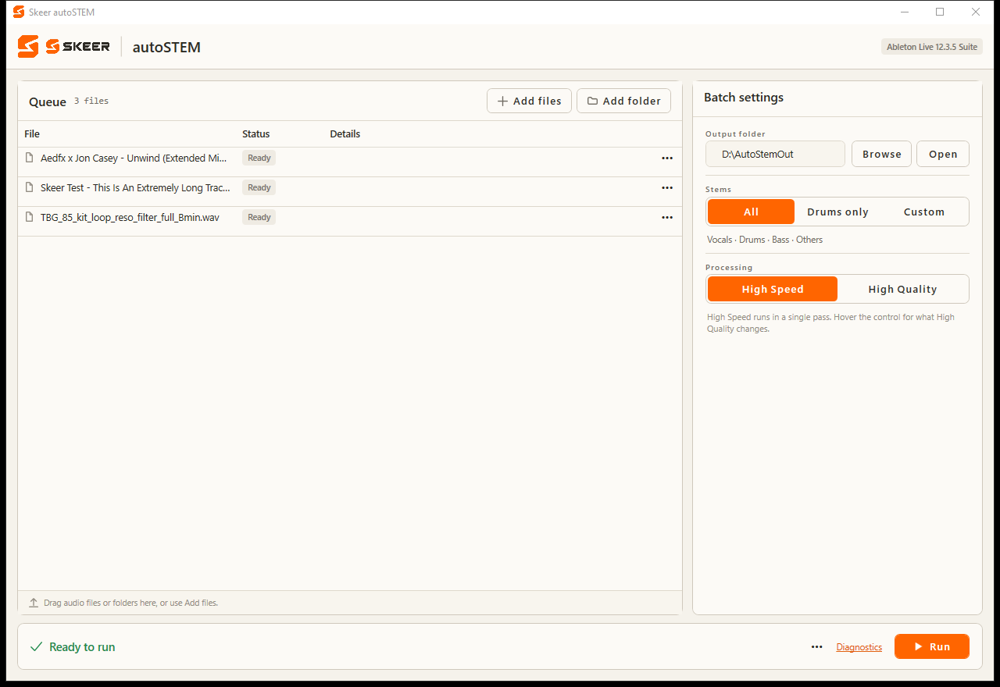
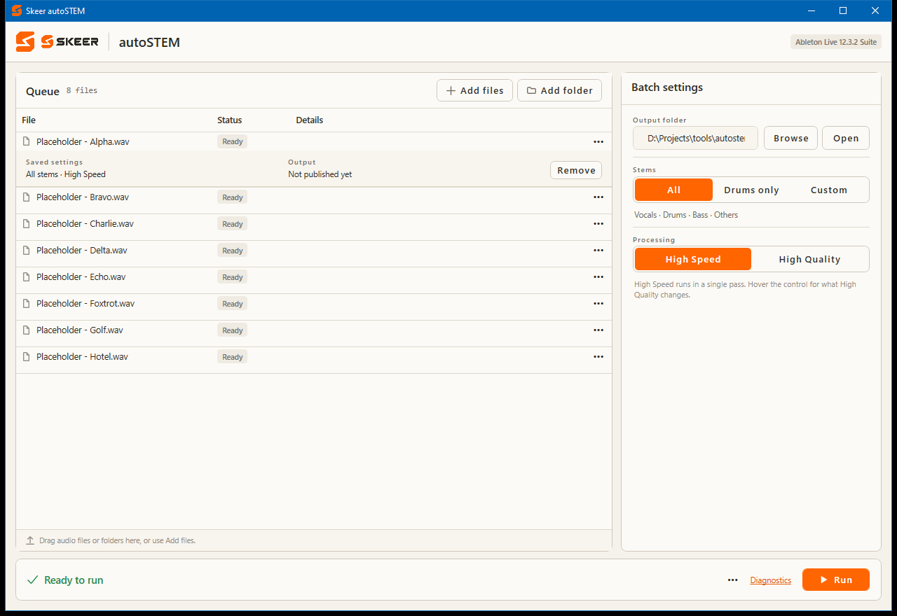
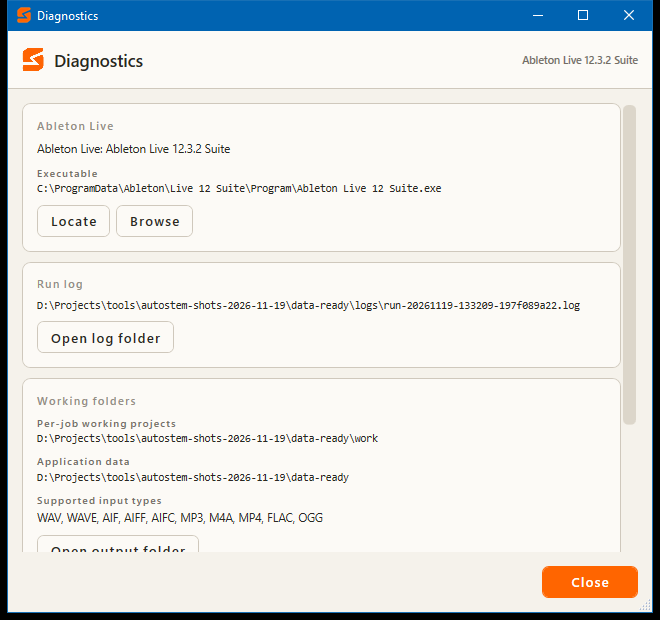
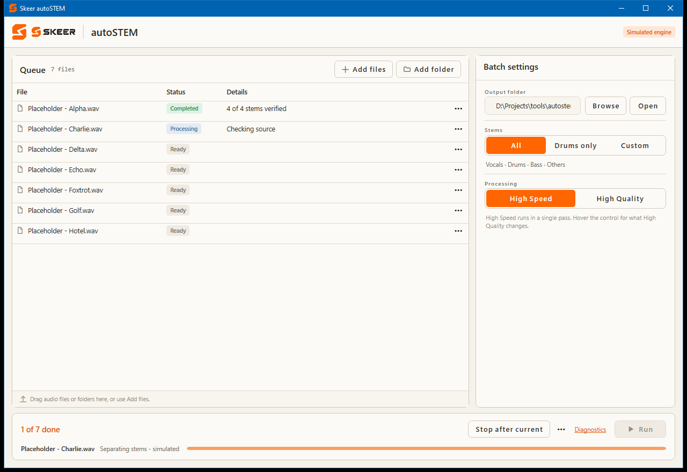
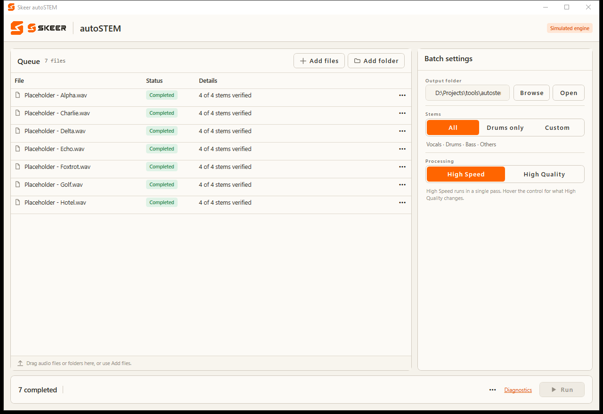
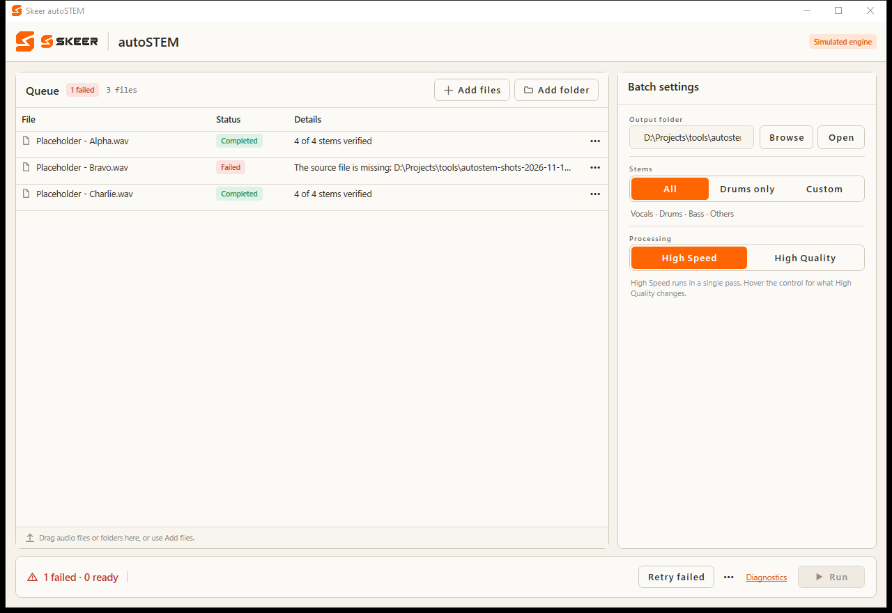
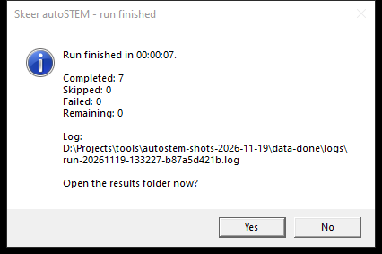

# Skeer autoSTEM

**Batch stem separation on Windows, driven through your own Ableton Live.**

*(Internal project name: StemForge. The executable is `SkeerAutoSTEM.exe`; the UI carries the
SKEER brand and module name, matching SKEER DJ Library. Version 1.1.0.)*

Skeer autoSTEM is a standalone desktop app that uses the stem separation engine already inside
your installed Ableton Live. Add files or folders, choose which stems and which processing mode,
press **Run**, and it launches Live, separates each track in turn, verifies the results and
publishes finished WAVs into readable per-track folders — so a batch can run unattended overnight.

It is not a plugin and installs none. There is no VST3, AU or AAX anywhere in this repository, and
nothing here registers with a DAW. Live stays the audio application; autoSTEM is the operator that
clicks it, on your desktop, on your machine, with your licence.

---

## Screens

All eight were captured from the published build (`launch/SkeerAutoSTEM.exe`, v1.1.0) with
`tools/capture-window.ps1`, which renders each window's own pixels with `PrintWindow` so the
capture stays clean even when other windows overlap it. No Ableton Live was launched to take any of
these shots — the states showing finished stems were produced by the app's own **simulated engine**
(see [Engines](#engines)), which writes placeholder WAVs and is labelled as not-Ableton output in
the app itself.

### Empty — nothing added yet



The whole window is the drop target, and Run is blocked with the reason written out: *Add a
supported file and choose an output folder.*

### Ready — three tracks queued



Rows carry their real status, the command bar counts from the same state as the rows, and Run is
enabled only now that a batch can actually start.

### A row's details



Per-row settings, the exact output file names, partial output and Remove live in this panel —
opened with the row's `•••` button or the "View details" link. A row saved with settings that
differ from the current batch says so here.

### Diagnostics



Detected Live build and executable path, run-log path, working folders, application-data folder,
the full list of supported input types, and the advanced options.

### Processing



The current file, its stage, and an indeterminate indicator whenever the engine reports no reliable
percentage. `Stop after current` is available the whole time.

### Completed



### Failed — with the reason, not just the colour



Red is reserved for failure, and Details carries the actual cause ("Source file not found: …"), so
the fix is readable without opening a log. `Retry failed` appears only when something failed.

### End of batch



---

## What it does

### The window

Three things are meant to be obvious at a glance: **which files are ready**, **what needs fixing**,
and **what happens when you click Run**.

- **Queue** (left): `File`, `Status` and `Details` columns. Long names truncate with an ellipsis and
  reveal the full path on hover. Status is a labelled badge — Ready, Processing, Completed, Failed,
  Skipped. Details carries the reason a track failed. A row's `•••` holds the per-row overrides.
- **Empty queue** shows a full drag-and-drop target; once files are present it shrinks to a one-line
  hint so a long batch keeps its room.
- **Batch settings** (right): output folder first (with Browse, and Open once it is set), then stems
  as a segmented `All / Drums only / Custom` control with a one-line summary
  (`Vocals · Drums · Bass · Others`), then `High Speed / High Quality`. Custom checkboxes appear only
  when Custom is selected; the longer mode explanation lives in a tooltip.
- **Command bar** (bottom): one row that replaces the old status footer. It shows the queue counts
  *from the same state as the rows* ("2 failed · 0 ready"), says why Run is blocked in plain
  language, and holds `Run` at a fixed position on the right. While running it shows the current
  file, the stage, an indeterminate indicator when there is no reliable percentage, and
  `Stop after current`. The progress row is hidden when idle.
- **Diagnostics** (link in the command bar): see the shot above.
- `•••` next to the queue actions holds housekeeping (clear completed, open output folder, open log
  folder); `Retry failed` appears only when something failed.
- Right-clicking **Add folder** offers **Include subfolders**, which is remembered between runs.

### Engines

`src/StemForge.Core/Engines/SeparatorFactory.cs` is the single place a setting becomes an engine,
and it is also where the honest "not yet" lives:

| Engine | Label in the UI | In this build |
| --- | --- | --- |
| `Live` | **Ableton Live** | **Yes.** Live's own separator, driven through UI Automation. Needs `Live 12.3 Suite or newer` and the desktop to itself for the duration of the run. |
| `Local` | **This machine** | **No.** A local model would give real progress and immediate cancellation without Ableton — it is not in this build, and asking for it fails with a message that says so. |
| `Cloud` | **Cloud** | **No.** |

The **simulated engine** is deliberately not an engine in that list. `--simulate`, or the
Diagnostics checkbox, swaps in a test double that writes placeholder stems and never reports them as
Ableton output; it exists to exercise the queue, resume and verification logic without a DAW. A
simulated run bypasses Live entirely, including the run-conditions and takeover dialogs.

### A run, start to finish

Per job the engine walks these stages, and the command bar names the one it is on:
`CheckingSource → PreparingProject → LaunchingLive → WaitingForLive → OpeningProject →
SelectingClip → OpeningStemDialog → ConfiguringStemDialog → Separating → CollectingStems →
VerifyingStems → Publishing`.

Before Live is touched, the app asks once and means it:

- **Run conditions** (`LiveRunCopy.RunConditions`) are shown before the first batch and list what
  has to stay in place — the detected Live build, the Suite condition, the screen hand-back, the
  lock-screen behaviour, the don't-click-during-those-seconds warning, the keep-awake request, and
  the display-scale constraint. Declining does not start a run.
- **Takeover** (`LiveSessionTakeover`): a run needs Live to itself, so Live is closed and reopened
  for each track. Before anything is closed the app lists every open session by title and asks.
  A set that was already saved is written where it lives. A set that was never saved goes to the
  recovery folder under a name built from its title and the clock, so nothing of yours is replaced.
  **A set that cannot be saved is not thrown away either — it is left open, the run stops before
  anything is closed, and the log names the session it stopped on.** The refusal path is a normal
  outcome, and both answers are recorded in the log.
- **The screen is yours between clicks** (`ScreenYield`): Live only accepts its own menu and clip
  commands while it is the front window, so it is raised, clicked, and the window you were looking
  at is handed back before the render starts. The decision is made from the actual foreground state
  and has six outcomes — including *the user has taken the screen back themselves*, in which case
  autoSTEM does not fight them for it.
- **Input is guarded before it is sent** (`DesktopGuard`, `GuardedInput`). Nothing is typed or
  clicked into a locked or unreadable desktop: three reads, then a refusal that tells you which
  problem it was (locked vs. no interactive desktop at all — only one is fixed by unlocking). Every
  keystroke and click checks who really owns the target point first, and refuses with a greppable
  code rather than firing blind:
  `desktop-not-interactive`, `target-window-gone`, `foreground-is-not-the-target`,
  `covered-at-the-target-point`. A refusal is a normal outcome, not an exception; the same refusal
  repeated across a batch is one grep, and a run that refused often is one count.
- **Live's tree is the only thing believed** (`CreateMenuChooser`). Live's accessibility patterns
  answer "success" whether or not anything happened, so every attempt to open the Create menu is
  followed by reading the popup back out of Live's own tree. Only a popup that is really there, with
  a really enabled *Separate Stems* entry, gets pressed; the states are `NotPoppedUp`,
  `ClosedAgain`, `GreyedOut`, `Pressable`, and the result is `Chosen`, `GreyedOut`, `NeverOpened` or
  `PressFailed`. A greyed-out entry is read as Live refusing the command, not as a click to repeat.
- **Windows is asked to stay awake** for the duration (`KeepAwakeDuringRun`, on by default), and the
  request is released when the run ends.

### Verification — nothing is published on trust

Every stem is checked before it is offered as a result (`StemVerifier`):

1. the file exists and is at least 1,000 bytes;
2. it is a `RIFF….WAVE`;
3. its duration matches the source within `max(0.05 s, 0.5 % of the source)`;
4. its sample rate and channel count are valid;
5. the cross-stem spread stays inside the same tolerance — the stems of one track must align with
   each other, not merely with the source;
6. SHA-256 and duration are recorded in the manifest.

A failed attempt keeps only the stems that individually **passed**, in a folder marked partial.
Partial output never counts as a finished result, is never offered as "Open results", and is never
reused by a later run.

### Publishing — the order is the safety

`writable probe on the destination → free space ≥ 2× what is staged → stage into
.autostem-staging\<job id> on the destination volume → verify the staged copy → write the manifest
with Complete=false → move the files → flip Complete=true last`. That last flip is the commit point:
a crash mid-publish leaves a folder that is repaired, not duplicated. Cleanup follows.

Source audio is only ever opened for reading.

### Resume and idempotence

- The queue, job transitions and run log are on disk, so an interrupted batch resumes with each
  job's original settings.
- A job id is a SHA-256 over source path, size, modification time, a quick content hash, the profile
  key and the destination — so the same file with the same choices is the same job, and a renamed or
  re-rendered source is not.
- The profile key is `{Stems}/{Mode}`: switching from All to Drums Only is a different job, not a
  redo of the first one.
- A completed job is skipped **only while its verified outputs still exist**. Delete a stem and the
  job is live again.
- A job caught in `Running` comes back as `Pending` with *"Interrupted - returned to the queue and
  will be retried."*
- A folder marked partial is never reused as though it were complete.

### Failure handling

`ErrorKind` is grouped by what the batch does about it, and the grouping is load-bearing:

| Group | Examples | Batch behaviour |
| --- | --- | --- |
| Source problems | `SourceMissing`, `SourceChanged`, `UnsupportedFormat`, `SourceUnreadable` | This job fails; the batch goes on to the next one. |
| Destination problems | `DestinationUnwritable`, `DestinationMissing`, `DiskFull` | The batch stops, and the queue is preserved until they are fixed. |
| Environment and engine | `LiveNotInstalled`, `LiveVersionUnsupported`, `LiveStartupFailed`, `LiveWindowNotFound`, `LiveLostFocus`, `DesktopLocked`, `LiveCrashed`, `UnexpectedDialog`, `LiveErrorDialog`, `SeparationTimeout` | The batch pauses and the queue stays intact for a resume once the cause is fixed. |
| Costed this job alone | `SeparationCancelled`, `StemsMissing`, `StemsUnverified`, `PublishFailed` | The batch walks on past them. |

A failure cause is written into the queue file **by name, not by position**, which is measured by a
test rather than assumed. That is also why a retired member stays declared: an old row still names
it, and a name this build does not have would make the whole file unreadable.

### Output

```
<Output folder>/
  Artist - Track/
    vocals.wav
    drums.wav
    bass.wav
    other.wav
  Artist - Track (Drums Only)/
    drums.wav
```

An `autostem.manifest.json` is written into every result folder. It records which job produced the
files, which stems and mode were used, and a hash and duration for each WAV — which is how
autoSTEM proves a result belongs to the current job and never reuses the wrong one. `autostem verify
<folder>` re-runs the whole check against that manifest.

### Input formats

WAV, WAVE, AIFF, AIF, AIFC, MP3, M4A, MP4, FLAC, OGG — the ten types listed in Diagnostics. Anything
else fails as `UnsupportedFormat` with the extension in the message. Live is asked to do the
decoding; autoSTEM never transcodes.

---

## Quick start

1. Run `SkeerAutoSTEM.exe` — the published build is a single self-contained executable, or install
   it with the setup program ([Packaging](#packaging-and-the-installer)).
2. Point **Output folder** at where the stems should land.
3. **Add Files**, **Add folder** or drag files/folders onto the window.
4. Leave **Stems** on *All* (the first-launch default) or pick *Drums Only* / *Custom*.
5. Leave **Processing mode** on *High Speed* (the first-launch default) or pick *High Quality*.
6. Press **Run**, read the conditions once, and read the takeover list whenever Live has sessions
   open.

Full instructions, including overnight operation and the constraints the automation depends on, are
in [docs/SETUP.md](docs/SETUP.md).

---

## Headless companion

The CLI drives exactly the same engine, which makes it useful for overnight batches, for scripting a
server of tracks, and for reproducing a GUI run. Nine commands:

```powershell
autostem locate                                  # list detected Live installs, with the same version AND edition verdict the Run button gives
autostem prepare "track.wav" --work D:\work      # build the working Live Set for a file and print its path
autostem enqueue "album" --dest D:\out           # fill the saved queue without running
               [--stems all|drums|vocals,drums] [--mode speed|quality]
autostem run "track.wav" --dest D:\out           # separate files (--stems, --mode, --simulate, --engine, --work)
autostem run "loop.wav"  --dest D:\out --simulate # no Ableton required
autostem verify "D:\out\Track"                   # re-verify a published result folder
autostem bench short.wav longer.wav --dest D:\bench # All vs Drums Only, both modes
autostem dump-ui [--window TEXT] [--depth N] [--open-menu NAME]
                                                 # dump the UI Automation tree of a window
autostem uia-invoke --button TEXT [--window TEXT] # press one element through UI Automation
autostem click-probe --name TEXT [--mode post|send|real|invoke]
                                                 # press one element and print the menus it owns before and after
```

`dump-ui`, `uia-invoke` and `click-probe` are also how this repo's automation is debugged: they read
and press Live's real tree instead of trusting a pattern that reports success while doing nothing.

---

## Where things live

Everything is under one application-data root — `%LOCALAPPDATA%\SkeerAutoSTEM` — holding settings,
queue, logs, working projects, staging and recovered sets. `STEMFORGE_DATA_ROOT` redirects that root
for tests and parallel runs. One file deliberately sits outside the override: the startup trace
always writes `%LOCALAPPDATA%\SkeerAutoSTEM\startup.log`, because it begins before the setting can be
read.

---

## Repository layout

```
src/StemForge.Core     engine: queue, verification, publishing, naming, Live automation, guards
src/StemForge.App      WPF desktop app (the product)
src/StemForge.App/Theme  the SKEER token set, defined once
tools/StemForge.Cli    headless companion + UI Automation diagnostics (autostem.exe)
tools/capture-window.ps1  PrintWindow screenshot tool used for the shots above
tests/StemForge.Tests  364 automated tests (see docs/TEST-REPORT.md for the recorded run)
docs/SETUP.md          setup guide, overnight operation, the constraints
docs/LIVE-AUTOMATION.md how the Live automation works, and what it depends on
docs/TEST-REPORT.md    test report, benchmarks, what is verified and what still needs a check
docs/LICENSING-REQUIREMENTS.md the licence and system-requirement gate, with sources
launch/                what you run: the exes, .NET notices, the installer (gitignored, built by build.ps1)
artifacts/             build intermediates: published app, companion, installers
```

---

## Build, test, package

```powershell
# build everything
dotnet build StemForge.slnx -c Release

# run the automated tests
dotnet test tests/StemForge.Tests/StemForge.Tests.csproj

# produce the single-file Windows build + installer, and fill the launch folder
./build.ps1
# -> launch/SkeerAutoSTEM.exe            (self-contained, no .NET install required)
# -> launch/autostem.exe                 (headless companion)
# -> launch/ThirdPartyNotices.dotnet.txt, LICENSE.dotnet-runtime.txt
#      (a self-contained build redistributes the .NET runtime, so Microsoft's
#       notices have to travel with it)
# -> launch/Skeer_autoSTEM_Setup_v1.1.0.exe
# (-SkipTests and -SkipInstaller are available; intermediates stay under artifacts/)
```

## Packaging and the installer

`packaging/SkeerAutoSTEM.iss` (Inno Setup 6) builds `Skeer_autoSTEM_Setup_v1.1.0.exe`.

- **Per-user on purpose.** `PrivilegesRequired=lowest`, and every file-class registry entry is under
  `HKCU`. A machine-wide `.wav` handler would replace this desk's player for every user; the HKCU
  default plus an `Open with` entry is the only way an installer can be offered on `.mp3` without
  stealing it. It installs for the user who runs it — nothing on this PC "for everyone".
- Both executables and both .NET notice files land in one `{app}` folder; one Start-menu group, an
  optional desktop icon, and a Start-menu entry for the notices.
- `CloseApplications=yes` and `ChangesAssociations=yes` — the latter is required whenever the script
  touches file classes, or neither install nor uninstall tells the shell to reload them.
- `AppId` is permanent: changing it installs side by side instead of replacing.
- **Version is single-sourced.** `<Version>` in `StemForge.App.csproj` is the one source: `build.ps1`
  reads it and passes `/DAppVersion` to ISCC, and the script refuses to default a second literal.
- **No plugin is installed, anywhere.** Nothing in this repository builds or ships a VST3/AU/AAX, so
  there is no DAW folder to write to and no duplicate browser entry to create.

---

## Visual identity

The UI follows the SKEER appearance system — the same tokens as SKEER DJ Library, defined once in
`src/StemForge.App/Theme/Skeer.xaml`:

| Token | Value |
| --- | --- |
| Canvas | `#F5F2EB` ivory |
| Panels | `#FCFAF6` paper on the ivory canvas, 1 px `#CFC8BC` border, 8 px radius |
| Ink | `#292821` charcoal, `#716C63` muted ink, `#938D83` muted soft |
| Signal | `#FF6500` orange — the only accent in the UI |
| Type | IBM Plex Sans / IBM Plex Mono / Barlow Condensed, falling back to Segoe UI / Consolas |
| Micro-labels | condensed, uppercase, 0.09 em tracking; buttons 0.06 em |

Warm ivory paper, pale stone, charcoal ink, one orange signal. Brand mark, wordmark and the Windows
icon come from the SKEER brand assets. The title bar is tinted to the palette where Windows supports
it; where it does not, the system chrome stays as it is. Because the condensed fonts may not be
installed, the font stack falls back the same way the DJ Library does, so both apps match on any
given machine.

---

## Requirements

- **Windows 10 22H2 (build 19045), 64-bit** — this is the machine everything here was built, tested
  and photographed on. The installer's floor is `MinVersion=10.0`. Windows 11 is expected to work and
  has **not** been recorded: no run on a Windows 11 machine is documented here, so no claim about one
  is made here either.
- **Ableton Live 12.3 Suite or newer**, installed separately, with its own licence. Stem separation
  is not in Standard, Intro or Lite. Developed and verified against **12.3.5 Suite** (which is the
  update-staging copy the locator refuses to start, so it is a reference, not the run target) and run
  end to end against **12.3.2 Suite** — the two installs this desk has. The app refuses a build it can
  identify as an unsupported version or an excluded edition; identification is by the name the install
  carries, not a licence check, so where nothing names an edition the app cannot tell and Live's own
  menu is the last word.
- A desktop that stays **unlocked**. Live needs a few seconds of real input per track to set a job up;
  the minutes-long render after that needs none, and the screen goes back to you for it. Locking stops
  the next track's clicks — nothing is ever typed into a lock screen — and the batch resumes after you
  unlock.
- The Live window must stay on the monitor where it was launched (it is maximised there). A display
  scale factor other than 100 % is handled.

## Licence and terms

**This product is licensed under the MIT licence** — see `LICENSE` at the repository root. The
installer shows it during setup and keeps a copy beside both executables. The grant covers
**our own code only**; model weights are not MIT (docs/LICENSING-REQUIREMENTS.md §3) and no
weights ship in this product.

The .NET runtime that the self-contained builds redistribute does travel with its terms:
`ThirdPartyNotices.dotnet.txt` and `LICENSE.dotnet-runtime.txt`, next to both executables in the
install folder. Ableton Live and its separator are Ableton's, licensed to you separately, and are
never bundled, copied or republished here.

## Status

Separation through Live is verified end to end on the machines above, the queue/verification/publish
logic is covered by the automated suite, and the installer's upgrade path has been re-checked against
an installed 1.1.0. What is *not* settled is recorded rather than hidden: [docs/TEST-REPORT.md](docs/TEST-REPORT.md)
lists exactly what has been verified against Ableton Live and what still needs a check on your own
machine, and [docs/LICENSING-REQUIREMENTS.md](docs/LICENSING-REQUIREMENTS.md) records the licence
gates. The local and cloud engines are not in this build.
